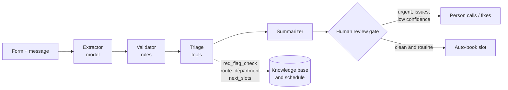

# Agentic Intake Copilot


A small, tested reference for how I design agentic AI (Artificial Intelligence) workflows: clear agent roles, typed tools, hard guardrails in code, a human-review gate, a full trace for every decision, and an eval set that runs in CI (Continuous Integration).

The example is a clinic intake desk. A patient sends a half-filled form and a free-text message. The copilot fills the gaps, checks the form, triages the case, writes a summary for the clinician, and decides whether a person must step in.

> All data in this repo is synthetic. This is a demo of the approach, not medical software and not code from any employer.

## How it works



| Agent | Job | Uses a model? |
|---|---|---|
| Extractor | Pull email, phone, date of birth, symptoms, pain score and duration from the message | Yes (offline rules by default, Claude optional) |
| Validator | Required fields, formats, consent | No, plain code |
| Triage | Red flags, priority, department, next slots | No, calls tools |
| Summarizer | Two-line note for the clinician | No, template |
| Gate | Send to a person if urgent, has issues, or confidence is low | No, plain code |

## Design decisions

- **Guardrails live in code, not in the prompt.** Red flags, validation and the review gate never depend on the model, so a model change can't switch them off.
- **The model's output is constrained.** It can only return symptoms that exist in the knowledge base. A test proves an invented symptom is dropped.
- **The patient's own form values win** over anything the model extracts.
- **Every step is traced** with its output and timing, so any decision can be explained to a clinician or an auditor.
- **Offline by default.** Tests and evals run with a deterministic backend, so results repeat and CI needs no API key.

## Quick start

```bash
git clone https://github.com/AmirPournajib/agentic-intake-copilot.git
cd agentic-intake-copilot
python -m intake_copilot demo     # three sample cases with the full trace
python -m intake_copilot eval     # score the eval set
pip install -r requirements-dev.txt && pytest -q
```

Sample output:

```text
[demo-urgent] REVIEW  URGENT | general | Sam Patel, 46 | Reason: Follow up | Symptoms: chest pain, shortness of breath | RED FLAGS: chest pain, shortness of breath. Call patient now.
  next slots: 2026-01-15T14:00, 2026-01-15T16:30
  review because: urgent case: a person must call
    - extractor  model.extract (offline)      {"found": {"symptoms": ["chest pain", "shortness of breath"]}, ...}
    - validator  rules                        {"issues": []}
    - triage     tool:red_flag_check          ["chest pain", "shortness of breath"]
    - triage     tool:route_department        "general"
    - triage     tool:next_slots              ["2026-01-15T14:00", "2026-01-15T16:30"]
    - gate       human_review                 ["urgent case: a person must call"]
```

To use Claude for extraction instead of the offline rules:

```bash
pip install anthropic
export ANTHROPIC_API_KEY=...
INTAKE_BACKEND=anthropic python -m intake_copilot demo
```

## Evals

21 labelled synthetic cases in [`evals/cases.jsonl`](evals/cases.jsonl). CI fails if any urgent case is missed.

| Metric | Offline backend |
|---|---|
| Urgent recall (must be 1.0) | 1.0 |
| Priority accuracy | 1.0 |
| Routing accuracy | 1.0 |
| Review gate accuracy | 1.0 |
| Human review rate | 0.48 |

These numbers come from a small set that the rules were written against, so they show the harness works, not real-world accuracy. The next step would be a larger held-out set and a shadow-mode pilot, as laid out in the [product brief](docs/PRD.md).

## Repo layout

```text
intake_copilot/
  agents.py     Extractor, Validator, Triage, Summarizer, Orchestrator and review gate
  tools.py      Typed tools the agents call
  llm.py        Offline and Claude backends behind one interface
  evals.py      Eval runner and report
data/           Knowledge base, schedule, sample cases
evals/          Labelled eval set
tests/          Unit, pipeline and guardrail tests
docs/PRD.md     One-page product brief: users, guardrails, metrics, rollout
```

## About

Built by [Amir Pournajib](https://amirpournajib.github.io), Technical Product Leader working on agentic AI, connected health and hardware. [LinkedIn](https://www.linkedin.com/in/amir-pournajib)
